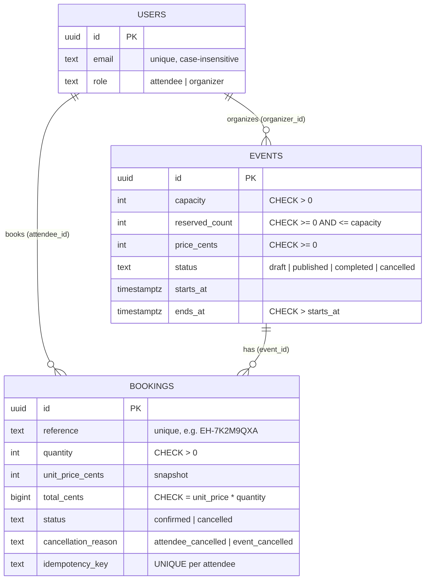

# EventHub

Full-stack event discovery and ticket-reservation platform. **Organizers** create, publish and manage events and monitor bookings; **attendees** discover events, reserve tickets, view and cancel their bookings. Bookings are reservations only - no payment is collected.

**Stack:** React 18 + Vite + Tailwind CSS 4 (frontend) · Node.js 20+ / Express 4 (API) · PostgreSQL 13+ · Zod (validation) · JWT + bcrypt (auth) · Vitest + Supertest (tests)

## Implemented features

- Register / sign in (JWT), two roles: `attendee` and `organizer` (one role per account - see *Design decisions*)
- Public discovery: search, category / location / date-range filters, sort by start time, server-side pagination, availability display, empty and error states
- Organizer: create / edit / publish / unpublish / cancel events, dashboard with capacity metrics and booking list
- Attendee: book 1-10 tickets with a confirmation dialog, booking confirmation + history + detail, cancel with clear "why not" messages
- **Oversell-proof booking** (atomic conditional UPDATE inside a transaction), idempotent retries, price snapshots, one-time capacity release on cancel
- 50 automated tests (unit + database-backed integration + real concurrency)

## Repository layout

```
backend/
  migrations/001_init.sql      schema, constraints, indexes
  src/
    domain/rules.js            pure business rules (lifecycle, cancellation policy, schedule validation)
    validators.js              Zod schemas (+ parse() -> 422 field errors)
    routes/                    HTTP only: auth, events (public + booking), organizer, bookings
    services/                  business logic + SQL: authService, eventService, bookingService
    middleware/                auth (JWT -> user, role checks), error handler
    scripts/migrate.js, seed.js
  tests/                       rules (unit), events (API), bookings (API + concurrency)
frontend/src/
  pages/  components/  api.js  auth.jsx  utils.js
```

## Core data model



Indexes: `events(status, starts_at)`, `events(organizer_id)`, `events(lower(category))`, `bookings(attendee_id, created_at DESC)`, `bookings(event_id, status)`, unique `users(lower(email))`.

**Money** is stored as integer minor units (`price_cents`, `total_cents`); no floating-point arithmetic anywhere. **Time** is stored as `timestamptz` (UTC). The API speaks ISO-8601; the browser shows/enters times in the user's local zone and converts to UTC. Date filters are sent as the start/end of the chosen local day.

## Run locally

Prerequisites: Node 20+, PostgreSQL 13+ (or Docker).

```bash


# 2. Backend
cd backend
cp .env.example .env          
npm install
npm run migrate              
npm run seed                  
npm run dev                   

# 3. Frontend (new terminal)
cd frontend
npm install
npm run dev                  
```

### Environment variables

| Backend (`backend/.env`) | Purpose |
|---|---|
| `NODE_ENV` | `development` / `production` / `test` |
| `PORT` | API port (default 4000) |
| `DATABASE_URL` | Postgres connection string |
| `TEST_DATABASE_URL` | Separate DB used by `npm test` (**tables are truncated**) |
| `DATABASE_SSL` | `true` for hosted DBs that require SSL |
| `JWT_SECRET` | Long random string; **required in production** |
| `JWT_EXPIRES_IN` | Token lifetime (default `7d`) |
| `BCRYPT_ROUNDS` | Hash cost (default 10) |
| `CORS_ORIGINS` | Comma-separated allowed browser origins (your frontend URL) |

| Frontend | Purpose |
|---|---|
| `VITE_API_URL` | API origin in production (empty in local dev) |
| `VITE_CURRENCY` | ISO currency code for display (default `USD`) |

## Tests

```bash
cd backend
npm test        
```

| # | Required area | Where |
|---|---|---|
| 1 | Event validation | `events.test.js` "event validation" |
| 2 | Draft/cancelled not visible or bookable | "event visibility" |
| 3 | Organizer ownership | "organizer ownership" |
| 4 | Booking quantity validation | `bookings.test.js` "booking validation" |
| 5 | Server-calculated totals | "server-calculated totals" |
| 6 | Capacity limits | "capacity limits" |
| 7 | **Concurrency** (2 x 4 tickets vs 5 left; 40 parallel buyers) | "concurrent bookings" |
| 8 | **Atomicity** (a DB trigger forces the INSERT to fail; reserved seats must roll back) | "atomicity" |
| 9 | Cancel frees capacity once (incl. 5 simultaneous cancels) | "cancellation frees capacity exactly once" |
| 10 | Booking privacy | "privacy" |
| 11 | Organizer booking access | "organizer ownership" + "privacy" |
| 12 | Price snapshot | "price snapshot" |
| 13 | Lifecycle rules | `rules.test.js` + "lifecycle rules" |

Also covered: idempotent retries / double-submit, DB `CHECK` backstop, auth/role enforcement, discovery filters and pagination, event cancellation preserving history, dashboard metrics. I also verified the concurrency tests are not vacuous: removing the capacity condition from the booking `UPDATE` makes them fail.

## Main API routes

All errors use `{ "error": { "code", "message", "details?" } }`. Statuses: 401 unauthenticated, 403 wrong role, 404 not found *or not yours*, 409 state/capacity conflicts, 422 validation (with per-field `details`).

| Method & path | Auth | Purpose |
|---|---|---|
| `POST /api/auth/register` · `POST /api/auth/login` · `GET /api/auth/me` | - / - / any | Auth, current user |
| `GET /api/events?q&category&location&from&to&sort&page&pageSize` | public | Published, upcoming events |
| `GET /api/events/categories` | public | Categories for the filter |
| `GET /api/events/:id` | public (owner sees own drafts) | Event detail + `remaining` |
| `POST /api/events/:id/bookings` `{quantity}` + optional `Idempotency-Key` header | attendee | Create booking (201; 200 on replay) |
| `GET /api/bookings` · `GET /api/bookings/:id` | attendee (own) | History, detail |
| `POST /api/bookings/:id/cancel` | attendee (own) | Cancel |
| `GET/POST /api/organizer/events` · `GET/PATCH /api/organizer/events/:id` | organizer (own) | List / create / read / edit |
| `POST /api/organizer/events/:id/{publish,unpublish,cancel}` | organizer (own) | Lifecycle transitions |
| `GET /api/organizer/events/:id/summary` · `.../bookings?status&page` | organizer (own) | Dashboard metrics, booking list |
| `GET /health` | public | DB connectivity check |

## Rules

**Event lifecycle** - `draft → published | cancelled`; `published → draft (unpublish) | completed | cancelled`; `completed` and `cancelled` are terminal. Status is never accepted from the client; only the transition endpoints change it.
- *Unpublish* is refused while confirmed bookings exist (cancel the event instead).
- *Completed* is automatic: published events past their end time are marked completed (on reads and every 60 s).
- *Edit* is allowed for draft/published only. Capacity cannot go below tickets already booked (409 `CAPACITY_BELOW_RESERVED`). Changing time or venue on an event that has bookings stamps `details_changed_at`; attendees then see a warning banner on the event and on their booking.
- *Cancel event*: every confirmed booking becomes `cancelled` with reason `event_cancelled`, its seats are released, and the rows are kept; attendees see "event cancelled" on the booking. No refunds (no payments).

**Booking** - quantity is a whole number from 1 to 10; event must be published and not yet started; quantity must fit remaining capacity. Total = unit price snapshot x quantity, computed on the server. States: `confirmed → cancelled` only.

**Cancellation cutoff** - an attendee may cancel a confirmed booking **until the event start time**. Blocked (409, with a message the UI displays) if already cancelled, event cancelled, event completed, or start time reached.

## How capacity is calculated and protected

`remaining = capacity − reserved_count`, where `reserved_count` = sum of quantities of *confirmed* bookings, kept in step inside the same transactions that change bookings. The dashboard re-derives it from the `bookings` table and exposes `counterInSync` as a self-check.

Booking runs in one transaction:

```sql
UPDATE events SET reserved_count = reserved_count + :qty
 WHERE id = :id AND status = 'published' AND starts_at > now()
   AND reserved_count + :qty <= capacity
RETURNING price_cents;          
INSERT INTO bookings (...) ;    
```

- The `UPDATE` check-and-reserve is a single atomic statement. Postgres row-locks the event; concurrent bookings queue and each re-evaluates the condition against the latest committed value, so two requests can never both pass.
- If the `INSERT` fails, the transaction rolls back and the reservation disappears (no partial state).
- The price snapshot is read from the same locked row that reserved the seats.
- `CHECK (reserved_count <= capacity)` is a last-resort backstop at the database level.
- Cancel (`confirmed → cancelled` + `reserved_count − qty`) and event edits/cancellation take the **event row lock first**, then booking rows, everywhere - one lock order, so no deadlocks. A cancel locks the booking and re-checks its status, so repeats and races release seats exactly once.

**Duplicate-submission safeguards:** the UI disables buttons while a request is in flight and generates one `Idempotency-Key` per booking attempt; the server has a `UNIQUE (attendee_id, idempotency_key)` constraint, so a retry or double-click returns the original booking (HTTP 200, `replayed: true`) and reserves nothing. Racing duplicates are resolved by that constraint (the loser's transaction rolls back).

## Organizer dashboard metrics

| Metric | Definition |
|---|---|
| Total capacity | `events.capacity` |
| Tickets booked | sum of `quantity` of **confirmed** bookings |
| Remaining | capacity − tickets booked |
| Confirmed bookings | count of confirmed bookings |
| Cancelled bookings | count of cancelled bookings (attendee- or event-cancelled); history is kept but they hold no capacity |
| Booked value | sum of `total_cents` of confirmed bookings (price snapshots; *not* money collected) |
| Cancelled value | sum of `total_cents` of cancelled bookings |

## Demo access

Seeded accounts (password `Password123!`): `organizer@example.com`, `organizer2@example.com`, `attendee@example.com`, `attendee2@example.com`. The sign-in page has one-click "Use demo attendee / organizer" buttons, and you can also self-register either role.

**Deployed URL:** _add after deploying_ · **Repository:** _add_

## Deployment (Render or similar)

`render.yaml` is a Blueprint starting point (Postgres + API web service + static frontend). Manually:
1. Create a Postgres database; copy its connection string.
2. API: root `backend`, build `npm install && npm run migrate`, start `npm start`, health check `/health`. Set `NODE_ENV=production`, `DATABASE_URL`, `JWT_SECRET` (random), `CORS_ORIGINS` (frontend URL), and `DATABASE_SSL=true` if your host requires SSL.
3. Frontend: root `frontend`, build `npm run build`, publish `dist`, rewrite `/*` → `/index.html` (`_redirects` and `vercel.json` included). Set `VITE_API_URL` to the API URL.
4. Optional demo data: run `npm run seed` once in the API shell.

Note: free tiers sleep when idle, so the first request after a pause can take 30-60 s; free Render Postgres instances expire after a limited period.

## Design decisions, limitations and trade-offs

- **One role per account** (attendee *or* organizer), chosen at registration. Organizers cannot book; this keeps permission rules simple and explicit. Role is re-read from the database on every request, never trusted from the token or client.
- **Non-owned resources return 404, not 403**, so IDs cannot be probed.
- **JWT in `localStorage`** (Bearer header) for simple cross-origin deployment. Trade-off: exposed to XSS; the production-grade alternative is an httpOnly, SameSite cookie with CSRF protection. React's escaping and Helmet reduce, but do not remove, that risk.
- Self-registration lets anyone choose the organizer role - acceptable for an assessment, not for production.
- Not implemented: rate limiting, email verification, password reset, refresh tokens, payments/refunds, waitlists, notifications, an admin role, per-user booking caps across bookings of the same event.
- Event "Completed" is derived from end time rather than set manually.
- Search uses `ILIKE`; fine at this scale, use `pg_trgm`/full-text search for large catalogs.
- Deployment config is provided but **not deployed or verified by the author of this scaffold** - test your deployed URL from a fresh browser session before submitting.

## AI-use disclosure

> _Edit this section so it reflects what you actually did and reviewed._

This project was generated with **Claude (Anthropic)** from the assessment brief: schema, API, tests and UI. The assistant ran the backend test suite against a real PostgreSQL 16 instance (50 passing), checked that removing the capacity guard makes the concurrency tests fail, built the frontend, and ran a jsdom smoke test of the login → browse → book → cancel → organizer-dashboard flows against the live API. It did **not** deploy the app or test it in a real browser. Things the submitter should personally review and be ready to explain: `bookingService.createBooking` and `cancelBooking` (transaction boundaries and lock order), `eventService.updateEvent` / `transition`, `middleware/auth.js`, and the capacity section above.
